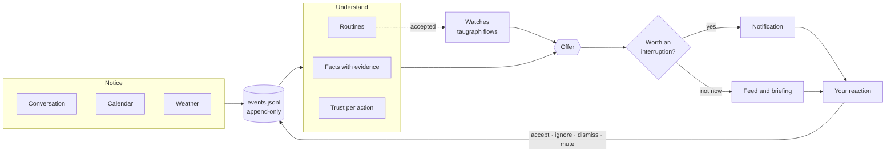
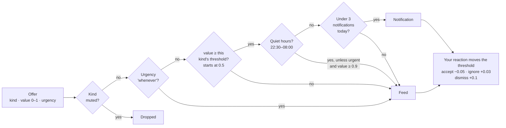

# moqi

[](https://github.com/wangcao-hub/moqi/actions/workflows/ci.yml) [](https://www.npmjs.com/package/moqi-agent) [](./LICENSE)

**A personal agent you don't have to ask.** moqi (默契, "tacit understanding") learns you from everyday life, speaks up first when it matters, and gets better at both the more you use it.

[中文文档](./README.zh-CN.md) · [Design (Chinese)](./docs/design.md) · Built on [taugraph](https://github.com/wangcao-hub/taugraph)

Most assistants wait to be asked. moqi works the other way round: ask the same thing three mornings in a row and on the fourth it tells you unasked; if it will rain tomorrow it reminds you the evening before; thirty minutes before a meeting it says so. It also knows when to stay quiet: no interruptions at night, at most three a day, and less of whatever you keep dismissing.

The core is plain TypeScript with no Node-only APIs, so the same code runs on a computer and inside a phone app.

## How it works

Everything moqi sees, says and does is an event in one append-only log. The user model is replayed from that log. Anything moqi wants to tell you becomes an **offer** that has to earn its way to your attention, and your reaction goes back into the log.



How one offer reaches you. The numbers are the defaults, and every kind of offer learns its own threshold.



## Design choices

| Choice                                                                                                                                                                                           | Why                                                                                                                                                                |
| ------------------------------------------------------------------------------------------------------------------------------------------------------------------------------------------------ | ------------------------------------------------------------------------------------------------------------------------------------------------------------------ |
| **Speaking up has a cost.** Every proactive message is an offer with a value. It interrupts you only if it beats its kind's learned threshold, is outside quiet hours and fits the daily budget. | Proactive without being noisy. What you keep dismissing gets rarer, what you accept gets through more easily.                                                      |
| **Trust is earned per kind of action.** Each kind climbs `inform → suggest → auto-undo → auto`. Three approvals in a row and moqi asks to move up; one refusal drops it back to `suggest`.       | There is no global "autonomous mode". Checking the weather can run on its own while anything that changes the world still asks. Forgetting is capped at `suggest`. |
| **Memories carry evidence.** A fact becomes long-term after three confirmations and fades after 30 days without one. A contradiction becomes a question for you.                                 | The model never silently overwrites what it knows about you.                                                                                                       |
| **Repetition becomes automation.** Use the same tool with the same arguments on 3 of the last 14 days, each time within an hour of the usual time, and moqi offers to do it for you.             | You don't set up automations; moqi notices the habit and asks once.                                                                                                |
| **Watches are deterministic flows.** A watch runs as a [taugraph](https://github.com/wangcao-hub/taugraph) graph: check (read), compare (code), alert (the only write step). No model call.      | Watches are cheap and predictable, and replaying a run never alerts you twice.                                                                                     |
| **Learning stays off the answer path.** Facts are extracted by a separate background request every three turns.                                                                                  | Replies never wait for memory, and a small local model doesn't have to answer and extract in one go.                                                               |
| **One log is the whole state.**                                                                                                                                                                  | Backing up is copying one file, debugging is reading it, and syncing devices later means syncing this log.                                                         |

## Quick start

Requires Node.js 22 or later. The npm package is `moqi-agent`; the command it installs is `moqi`.

```
npm install -g moqi-agent
moqi init        # writes ~/.moqi/config.json
moqi             # chat, while moqi keeps an eye out in the background
```

Point the config at any OpenAI-compatible model. A local Ollama works (the template uses `qwen3:4b`; run `ollama pull qwen3:4b` first), and so do DeepSeek, Qwen and other hosted models. If replies get cut off as a conversation grows, give Ollama a larger context window, e.g. `OLLAMA_CONTEXT_LENGTH=16384 ollama serve`.

```
你：我住在深圳南山，在一家互联网公司做产品
moqi：记住了
你：每天晚上 10 点提醒我早点睡
要我每天 22:00提醒你「早点睡」吗？ [y/N] y
moqi：好，每天 22:00 替你提醒「早点睡」
```

(The CLI's own messages are in Chinese for now.)

Commands inside the chat: `/brief`, `/offers`, `/accept <id>`, `/dismiss <id>`, `/mute <id>`, `/unmute <kind>`, `/memory`, `/watches`, `/trust`, `/help`, `/quit`.

- `moqi daemon` keeps watch without a chat and reaches you through system notifications (macOS, Linux). To keep it running, start it with whatever you use for background services (launchd, systemd, pm2).
- `moqi brief` prints today's briefing.
- Only one moqi process can use a home directory at a time, so stop the daemon before you open a chat. While a chat is open it does the daemon's job too.

## Configuration

`~/.moqi/config.json` (the directory can be changed with `MOQI_HOME`):

```json
{
  "model": { "baseURL": "http://127.0.0.1:11434/v1", "model": "qwen3:4b", "noThink": true },
  "persona": "Keep answers short.",
  "briefingAt": "08:00",
  "quiet": { "from": "22:30", "to": "08:00" },
  "dailyBudget": 3,
  "weather": { "latitude": 22.54, "longitude": 113.93, "place": "Shenzhen" },
  "calendar": { "ics": "~/calendar.ics" }
}
```

| Field           | Default        | Meaning                                                                                                                              |
| --------------- | -------------- | ------------------------------------------------------------------------------------------------------------------------------------ |
| `model`         | none           | OpenAI-compatible endpoint: `baseURL`, `model`, optional `apiKey`. Without a model, briefings and watches still work; chat does not. |
| `model.noThink` | off            | For Qwen3-style models that think first: background requests get the `/no_think` switch.                                             |
| `persona`       | none           | Who moqi is to you; put at the top of the system prompt.                                                                             |
| `briefingAt`    | `"08:00"`      | Time of the daily briefing; `null` turns it off.                                                                                     |
| `quiet`         | 22:30 to 08:00 | Quiet hours: offers wait in the feed unless they are urgent and worth 0.9 or more.                                                   |
| `dailyBudget`   | `3`            | Most notifications per day.                                                                                                          |
| `weather`       | off            | Weather plugin (Open-Meteo, no key).                                                                                                 |
| `calendar`      | off            | Calendar plugin reading a local `.ics` file.                                                                                         |

Environment variables: `MOQI_BASE_URL` with `MOQI_MODEL` replaces the model; `MOQI_API_KEY` supplies the key so it stays out of the file.

## What it does unasked

| When                                                          | What                                                                                              | From                   |
| ------------------------------------------------------------- | ------------------------------------------------------------------------------------------------- | ---------------------- |
| Every morning (`briefingAt`)                                  | A briefing: today's calendar and weather, things kept for you, decisions waiting, today's watches | core                   |
| You ask the same thing at about the same time on several days | Offers to tell you every day without being asked; accepting creates a watch                       | core (routines)        |
| A watch is due                                                | Checks, compares with last time, tells you if it changed (or every time)                          | core (a taugraph flow) |
| Two memories contradict                                       | Asks which one is right                                                                           | core                   |
| Three approvals in a row for one kind of action               | Offers to do that kind of action without asking                                                   | core                   |
| After 8 pm, if tomorrow needs an umbrella                     | Says so                                                                                           | weather plugin         |
| 30 minutes before an event                                    | Says it is coming                                                                                 | calendar plugin        |

## Use it as a library

```
npm install moqi-agent zod
```

A plugin contributes tools, a section of the daily briefing and work for each heartbeat:

```ts
import { defineTool, Moqi, openAICompatible, type Plugin } from "moqi-agent";
import { weatherPlugin } from "moqi-agent/plugins";
import { z } from "zod";

const water: Plugin = {
  name: "water",
  tools: [
    defineTool({
      name: "water_log",
      description: "How many glasses of water the user drank today",
      input: z.object({}),
      effect: "read",
      run: () => ({ value: "3", headline: "3 glasses today" }),
    }),
  ],
  briefing: () => ({ title: "Water", lines: ["Only 3 glasses yesterday"] }),
  tick: (ctx) => {
    // Look at the world and call ctx.offer(...) when there is something to say.
    // moqi decides whether it becomes a notification, waits in the feed, or is dropped.
  },
};

const moqi = new Moqi({
  model: openAICompatible({ baseURL: "http://127.0.0.1:11434/v1", model: "qwen3:4b" }),
  plugins: [weatherPlugin({ latitude: 22.54, longitude: 113.93, place: "Shenzhen" }), water],
  deliver: (offer, surface) => console.log(surface, offer.title), // surface is "notify" or "feed"
});

console.log(await moqi.chat("Do I need an umbrella tomorrow?"));
setInterval(() => void moqi.tick(), 60_000); // the proactive heartbeat
```

`effect: "read"` tools run freely and can be used by watches. `"write"` tools start at "ask first" and earn trust; pass `confirm: (question) => Promise<boolean>` to ask the user, otherwise unearned writes are refused. State lives in memory by default; `fileEventStore` from `moqi-agent/node` keeps it in a JSONL file.

## Data and privacy

All state is replayed from `~/.moqi/events.jsonl`, one event per line, append-only. API keys never go into the log, and `config.json` is created readable only by you.

Two things leave your computer: requests to the model endpoint you configured (the conversation plus the memories moqi includes in the prompt), and, if the weather plugin is on, your configured coordinates sent to Open-Meteo. With a local model, the weather request is the only one.

## Status and limits

Version 0.1 runs on a computer: core, CLI, weather and calendar plugins, notifications, watches, routines and background learning.

- The phone app and multi-device sync are next. The core already follows the rules needed to run on a phone, and a test enforces them.
- Repeating calendar events (RRULE) are not expanded yet.
- Small local models (4B) sometimes record one-off requests as facts. Check with `/memory`; ask moqi to forget anything wrong.
- `auto-undo` currently means "do it and tell you"; undoing is the matching cancel action.
- A chat cannot attach to a running daemon yet (see the note in Quick start).

## Development

```
pnpm install
pnpm check      # typecheck, lint, tests (pinned to Asia/Shanghai)
```

## License

[MIT](./LICENSE)
