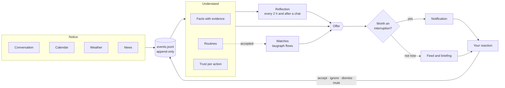
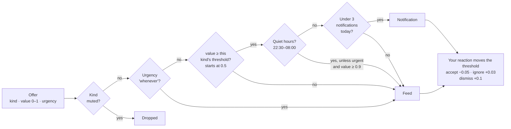
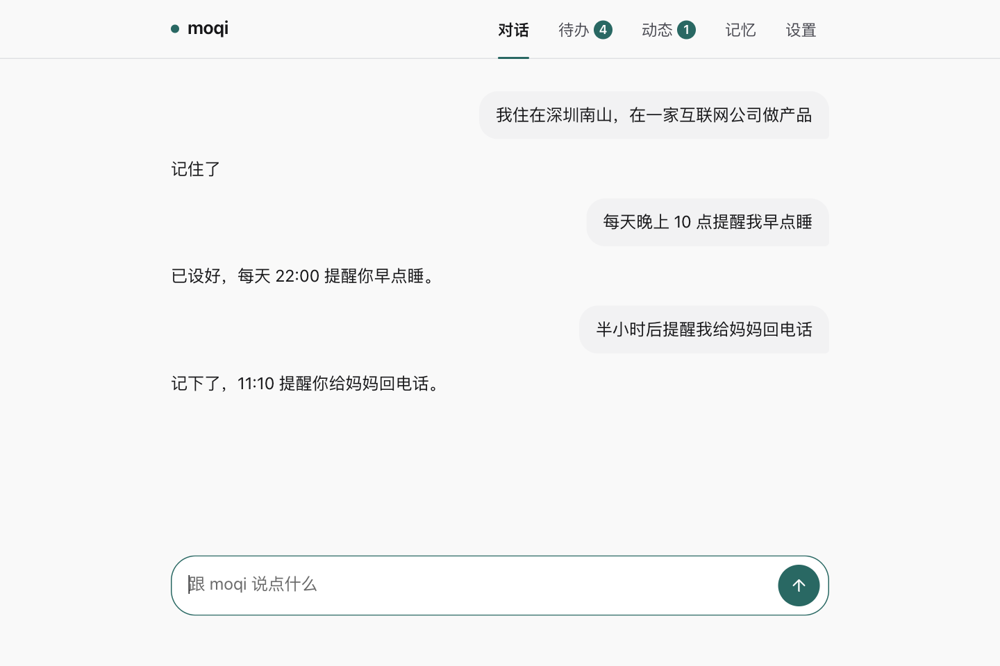

# moqi

[](https://github.com/wangcao-hub/moqi/actions/workflows/ci.yml) [](https://www.npmjs.com/package/moqi-agent) [](./LICENSE)

**A personal agent you don't have to ask.** moqi (默契, "tacit understanding") learns you from everyday life, speaks up first when it matters, and gets better at both the more you use it.

[中文文档](./README.zh-CN.md) · [Design (Chinese)](./docs/design.md) · Built on [taugraph](https://github.com/wangcao-hub/taugraph)

Most assistants wait to be asked. moqi works the other way round. Every couple of hours, and soon after you talk to it, it thinks about you on its own: what it could do for you, what it should ask to understand you better, which news matters to you. Ask the same thing three mornings in a row and on the fourth it tells you unasked; if it will rain tomorrow it reminds you the evening before. It also knows when to stay quiet: no interruptions at night, at most three a day, and less of whatever you keep dismissing.

The core is plain TypeScript with no Node-only APIs, so the same code runs on a computer and inside a phone app.

## How it works

Everything moqi sees, says and does is an event in one append-only log. The user model is replayed from that log. Anything moqi wants to tell you becomes an **offer** that has to earn its way to your attention, and your reaction goes back into the log.



How one offer reaches you. The numbers are the defaults, and every kind of offer learns its own threshold.



## Design choices

| Choice                                                                                                                                                                                                                                                                                                                       | Why                                                                                                                                                                                                                                         |
| ---------------------------------------------------------------------------------------------------------------------------------------------------------------------------------------------------------------------------------------------------------------------------------------------------------------------------- | ------------------------------------------------------------------------------------------------------------------------------------------------------------------------------------------------------------------------------------------- |
| **It thinks on its own.** Every two hours while you are awake, and ten minutes after a conversation settles, moqi asks the model for up to three ideas: something to do for you (with the action ready, one tap sets it up), a question to know you better (two a day at most), or news from your feeds that matters to you. | Being proactive means thinking when nobody asks. Ideas go through the same gate as everything else, only ones that matter today may interrupt, none repeats within a week, and the console shows every idea and why it was or was not sent. |
| **Speaking up has a cost.** Every proactive message is an offer with a value. It interrupts you only if it beats its kind's learned threshold, is outside quiet hours and fits the daily budget.                                                                                                                             | Proactive without being noisy. What you keep dismissing gets rarer, what you accept gets through more easily.                                                                                                                               |
| **Trust is earned per kind of action.** Each kind climbs `inform → suggest → auto-undo → auto`. Three approvals in a row and moqi asks to move up; one refusal drops it back to `suggest`.                                                                                                                                   | There is no global "autonomous mode". Checking the weather can run on its own while anything that changes the world still asks. Forgetting is capped at `suggest`.                                                                          |
| **Memories carry evidence.** A fact becomes long-term after three confirmations and fades after 30 days without one. A contradiction becomes a question for you.                                                                                                                                                             | The model never silently overwrites what it knows about you.                                                                                                                                                                                |
| **Repetition becomes automation.** Use the same tool with the same arguments on 3 of the last 14 days, each time within an hour of the usual time, and moqi offers to do it for you.                                                                                                                                         | You don't set up automations; moqi notices the habit and asks once.                                                                                                                                                                         |
| **Watches are deterministic flows.** A watch runs as a [taugraph](https://github.com/wangcao-hub/taugraph) graph: check (read), compare (code), alert (the only write step). No model call.                                                                                                                                  | Watches are cheap and predictable, and replaying a run never alerts you twice.                                                                                                                                                              |
| **Learning stays off the answer path.** Facts are extracted by a separate background request every three turns.                                                                                                                                                                                                              | Replies never wait for memory, and a small local model doesn't have to answer and extract in one go.                                                                                                                                        |
| **One log is the whole state.**                                                                                                                                                                                                                                                                                              | Backing up is copying one file, debugging is reading it, and syncing devices later means syncing this log.                                                                                                                                  |

## Quick start

Requires Node.js 22 or later. The npm package is `moqi-agent`; the command it installs is `moqi`.

```
npm install -g moqi-agent
moqi             # starts moqi in the background and opens its console in your browser
```



The console lives at **http://moqi.localhost:6674** (6674 spells MOQI on a phone keypad). The first time, `moqi` opens it with a key in the link; the browser remembers the key, so afterwards typing the address is enough. If your browser does not resolve `moqi.localhost`, use `http://localhost:6674`.

It has four tabs: **Chat**, **Feed** (what moqi wants to tell you, its questions with an answer box, and "moqi 在想": every idea it had and what became of it), **Memory** (what it remembers about you and what it watches for you; delete anything wrong) and **Settings**. The first time, it opens on Settings: pick a model, press "test connection", search for your city, pick news feeds, save. Changes apply at once, without a restart. The console's own text is in Chinese for now.

Any OpenAI-compatible model works. A local Ollama needs no key: `qwen3:4b` (2.5 GB) runs anywhere, and [Muse Glimmer](https://ollama.com/library/muse-glimmer), Meta's open-weights model for always-on local agents, thinks far better if you have the room (about 18 GB on disk, 24 GB of memory or more). DeepSeek, Qwen and other hosted models need a key. If replies get cut off as a conversation grows, give Ollama a larger context window, e.g. `OLLAMA_CONTEXT_LENGTH=16384 ollama serve`.

| Command       | What it does                                                                                                         |
| ------------- | -------------------------------------------------------------------------------------------------------------------- |
| `moqi`        | Starts moqi in the background if it is not running, then opens the console                                           |
| `moqi stop`   | Stops the background moqi                                                                                            |
| `moqi brief`  | Prints today's briefing                                                                                              |
| `moqi chat`   | Chats in the terminal, when the background moqi is not running (`/brief`, `/offers`, `/accept <id>`, `/memory`, ...) |
| `moqi daemon` | Runs in the foreground without opening a browser, for launchd, systemd or pm2                                        |
| `moqi init`   | Writes a config template, for machines without a browser                                                             |

The background moqi reaches you through system notifications (macOS, Linux) and the console's feed. One moqi owns a home directory at a time; the console, `moqi brief` and (later) the phone all go through it.

## Configuration

The Settings tab writes `~/.moqi/config.json`; you can also edit it by hand (the directory can be changed with `MOQI_HOME`):

```json
{
  "model": { "baseURL": "http://127.0.0.1:11434/v1", "model": "qwen3:4b", "noThink": true },
  "persona": "Keep answers short.",
  "briefingAt": "08:00",
  "quiet": { "from": "22:30", "to": "08:00" },
  "dailyBudget": 3,
  "weather": { "latitude": 22.54, "longitude": 113.93, "place": "Shenzhen" },
  "calendar": { "ics": "~/calendar.ics" },
  "news": { "feeds": [{ "name": "少数派", "url": "https://sspai.com/feed" }] }
}
```

| Field           | Default                 | Meaning                                                                                                                                |
| --------------- | ----------------------- | -------------------------------------------------------------------------------------------------------------------------------------- |
| `model`         | none                    | OpenAI-compatible endpoint: `baseURL`, `model`, optional `apiKey`. Without a model, briefings and watches still work; chat does not.   |
| `model.noThink` | off                     | For Qwen3-style models that think first: background requests get the `/no_think` switch.                                               |
| `persona`       | none                    | Who moqi is to you; put at the top of the system prompt.                                                                               |
| `briefingAt`    | `"08:00"`               | Time of the daily briefing; `null` turns it off.                                                                                       |
| `quiet`         | 22:30 to 08:00          | Quiet hours: offers wait in the feed unless they are urgent and worth 0.9 or more.                                                     |
| `dailyBudget`   | `3`                     | Most notifications per day.                                                                                                            |
| `weather`       | off                     | Weather plugin (Open-Meteo, no key).                                                                                                   |
| `calendar`      | off                     | Calendar plugin reading a local `.ics` file.                                                                                           |
| `news`          | 少数派, IT之家, Solidot | News plugin: RSS or Atom feeds to read headlines from; `{ "feeds": [] }` turns it off. The console also offers 爱范儿 and Hacker News. |
| `model.effort`  | none                    | `low`, `medium` or `high`: reasoning strength for background work, for models that support it (Muse Glimmer, gpt-oss).                 |

Environment variables: `MOQI_BASE_URL` with `MOQI_MODEL` replaces the model; `MOQI_API_KEY` supplies the key so it stays out of the file.

## What it does unasked

| When                                                          | What                                                                                              | From                   |
| ------------------------------------------------------------- | ------------------------------------------------------------------------------------------------- | ---------------------- |
| Every morning (`briefingAt`)                                  | A briefing: today's calendar and weather, things kept for you, decisions waiting, today's watches | core                   |
| Every two hours, and soon after a chat                        | Ideas: something to do for you, a question to know you better, news that matters to you           | core (reflection)      |
| You ask the same thing at about the same time on several days | Offers to tell you every day without being asked; accepting creates a watch                       | core (routines)        |
| A watch is due                                                | Checks, compares with last time, tells you if it changed (or every time)                          | core (a taugraph flow) |
| Two memories contradict                                       | Asks which one is right                                                                           | core                   |
| Three approvals in a row for one kind of action               | Offers to do that kind of action without asking                                                   | core                   |
| After 8 pm, if tomorrow needs an umbrella                     | Says so                                                                                           | weather plugin         |
| 30 minutes before an event                                    | Says it is coming                                                                                 | calendar plugin        |

## Use it as a library

```
npm install moqi-agent zod
```

A plugin contributes tools, a section of the daily briefing and work for each heartbeat:

```ts
import { defineTool, Moqi, openAICompatible, type Plugin } from "moqi-agent";
import { weatherPlugin } from "moqi-agent/plugins";
import { z } from "zod";

const water: Plugin = {
  name: "water",
  tools: [
    defineTool({
      name: "water_log",
      description: "How many glasses of water the user drank today",
      input: z.object({}),
      effect: "read",
      run: () => ({ value: "3", headline: "3 glasses today" }),
    }),
  ],
  briefing: () => ({ title: "Water", lines: ["Only 3 glasses yesterday"] }),
  tick: (ctx) => {
    // Look at the world and call ctx.offer(...) when there is something to say.
    // moqi decides whether it becomes a notification, waits in the feed, or is dropped.
  },
};

const moqi = new Moqi({
  model: openAICompatible({ baseURL: "http://127.0.0.1:11434/v1", model: "qwen3:4b" }),
  plugins: [weatherPlugin({ latitude: 22.54, longitude: 113.93, place: "Shenzhen" }), water],
  deliver: (offer, surface) => console.log(surface, offer.title), // surface is "notify" or "feed"
});

console.log(await moqi.chat("Do I need an umbrella tomorrow?"));
setInterval(() => void moqi.tick(), 60_000); // the proactive heartbeat
```

`effect: "read"` tools run freely and can be used by watches. `"write"` tools start at "ask first" and earn trust; pass `confirm: (question) => Promise<boolean>` to ask the user, otherwise unearned writes are refused. State lives in memory by default; `fileEventStore` from `moqi-agent/node` keeps it in a JSONL file.

## Data and privacy

All state is replayed from `~/.moqi/events.jsonl`, one event per line, append-only. API keys never go into the log, and `config.json` is created readable only by you.

The console listens on `127.0.0.1` only. Its address carries a random key after `#`, so the key never reaches a server log; every API call must present it, requests whose `Host` is not this machine are refused (against DNS rebinding), and the page loads nothing from outside under a strict Content Security Policy. A saved API key is never sent to the page.

What leaves your computer: requests to the model endpoint you configured (the conversation plus the memories and headlines moqi includes in the prompt), your configured coordinates sent to Open-Meteo if the weather plugin is on, and plain downloads of the news feeds you picked. With a local model, nothing about you leaves at all.

## Status and limits

moqi runs on a computer: core, console, CLI, weather and calendar plugins, notifications, watches, routines and background learning.

- The phone app and multi-device sync are next. The core already follows the rules needed to run on a phone, and a test enforces them.
- Repeating calendar events (RRULE) are not expanded yet.
- Small local models (4B) sometimes record one-off requests as facts. Check with `/memory`; ask moqi to forget anything wrong.
- Reflection is only as good as the model. With `qwen3:4b` a reflection takes about a minute and yields one to three ideas, sometimes none; a bigger model, such as [Muse Glimmer](https://ollama.com/library/muse-glimmer) locally or a hosted one, thinks much better.
- `auto-undo` currently means "do it and tell you"; undoing is the matching cancel action.
- The terminal chat (`moqi chat`) does not attach to the background moqi yet; use the console while it runs.

## Development

```
pnpm install
pnpm check      # typecheck, lint, tests (pinned to Asia/Shanghai)
```

## License

[MIT](./LICENSE)
