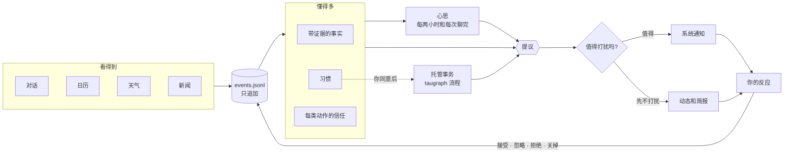
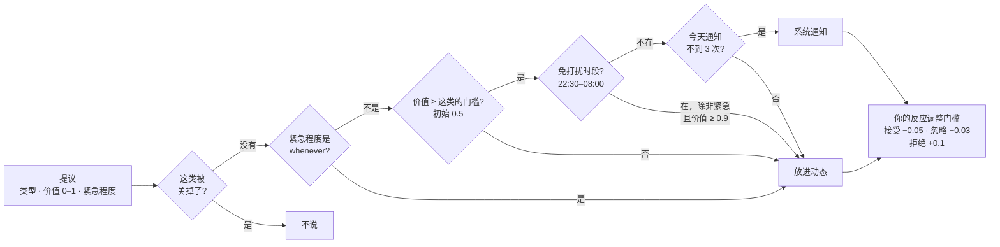
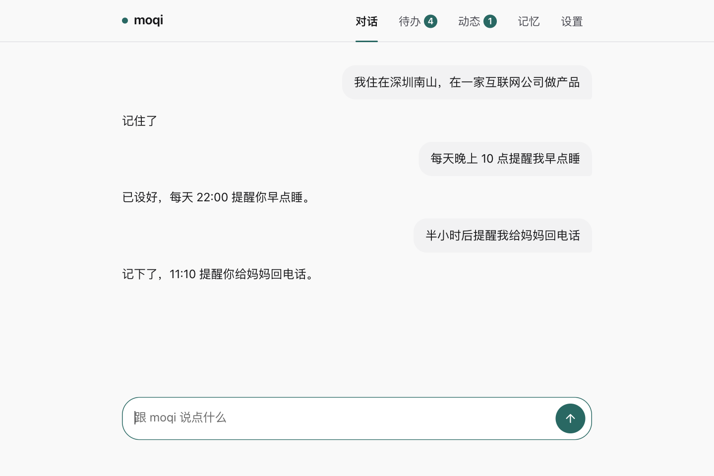

# moqi（默契）

[](https://github.com/wangcao-hub/moqi/actions/workflows/ci.yml) [](https://www.npmjs.com/package/moqi-agent) [](./LICENSE)

**不用开口就懂你的个人 agent。** 它从你的日常里了解你，在合适的时候先开口，越用越懂你。

[English](./README.md) · [设计](./docs/design.md) · 基于 [taugraph](https://github.com/wangcao-hub/taugraph)

大多数助理等你来问。moqi 反过来：每隔两小时，以及每次和你聊完，它都会自己想一想，能替你做点什么、该问你点什么好更懂你、外面有什么和你有关的事。你问过三次的事，第四次它直接告诉你；明天要下雨，它前一晚提醒你带伞。它也知道什么时候该闭嘴：晚上不打扰、一天最多打扰三次、你嫌烦的那类事它会越来越少说。

内核是纯 TypeScript，不依赖 Node 专有 API，同一份代码可以跑在电脑上，也可以放进手机 App。

## 怎么运转

moqi 看到的、说过的、做过的，全部是一份只追加日志里的事件，用户模型由这份日志重放得到。它想对你说的每一句话都先变成一条**提议**，要过几道关才能打扰你；你的反应再写回日志。



一条提议怎么到你面前。图里是默认值，每一类提议各自学自己的门槛：



## 设计取舍

| 取舍                                                                                                                                                                                                       | 为什么                                                                                                                                                 |
| ---------------------------------------------------------------------------------------------------------------------------------------------------------------------------------------------------------- | ------------------------------------------------------------------------------------------------------------------------------------------------------ |
| **它会自己想。** 你醒着的时候每两小时一次，以及每次聊完 10 分钟后，moqi 请模型想最多三个点子：替你做一件事（动作已经备好，点一下就办）、问你一个问题好更懂你（每天最多两个）、从你订阅的新闻里挑和你有关的 | 主动就是没人问的时候也在想。点子和别的提议过同样的关：只有今天就要用上的才会打扰你，一周内不重复，控制台里能看到它想过的每一件事，以及为什么说了或没说 |
| **开口是有代价的。** 每条主动消息都是一条带价值的提议。它要超过这一类学到的门槛、不在免打扰时段、还有当天的打扰额度，才会弹通知                                                                            | 主动但不吵。你总拒绝的那类越来越少出现，你常接受的那类更容易送到                                                                                       |
| **信任按事情一件一件挣。** 每类动作沿 `inform → suggest → auto-undo → auto` 往上走。连续同意 3 次，moqi 才问要不要升一级；拒绝一次降回 `suggest`                                                           | 没有全局的"自动模式"。查天气可以自己跑，会改变外部世界的事照样先问。删除记忆封顶在 `suggest`                                                           |
| **记忆带证据。** 同一事实印证 3 次转为长期，30 天没再印证就淡出；前后矛盾时变成一个问题交给你                                                                                                              | 模型不会悄悄改写它对你的了解                                                                                                                           |
| **重复变成自动化。** 最近 14 天里有 3 天用同样的参数调用同一个工具，每次都在平时那个时间前后一小时内，moqi 就提议以后替你做                                                                                | 自动化不用你去设置，moqi 看出习惯，问你一次                                                                                                            |
| **托管事务是确定性流程。** 每件托管事务按 [taugraph](https://github.com/wangcao-hub/taugraph) 流程跑：检查（只读）、比较（代码）、提醒（唯一的写步骤），不调用模型                                         | 便宜、可预期，重放一次运行也不会重复提醒你                                                                                                             |
| **学习不挡在回答前面。** 每 3 轮对话，后台另发一次请求抽取事实                                                                                                                                             | 回答不用等记忆；本机小模型也不用一边回答一边抽取                                                                                                       |
| **一份日志就是全部状态。**                                                                                                                                                                                 | 备份就是复制一个文件，排查问题就是读它，以后多设备同步就是同步这份日志                                                                                 |

## 快速开始

需要 Node.js 22 或更高版本。npm 上的包名是 `moqi-agent`，装好后的命令是 `moqi`。

```
npm install -g moqi-agent
moqi             # 在后台运行 moqi，并在浏览器里打开控制台
```



控制台的地址是 **http://moqi.localhost:6674**（6674 在手机键盘上就是 MOQI）。第一次 `moqi` 会用带钥匙的链接打开它，浏览器记住钥匙之后，直接输入这个地址就行。如果你的浏览器打不开 `moqi.localhost`，用 `http://localhost:6674`。

控制台有四个栏目：**对话**；**动态**（moqi 主动想告诉你的事、它问你的问题（可以直接回答），以及「moqi 在想」：它想过的每个点子和结果）；**记忆**（它记住了你什么、替你盯着什么，记错的可以删）；**设置**。第一次打开会直接进设置：选一个模型，点「测试连接」，搜一下你的城市，选几个新闻源，保存。改完立刻生效，不用重启。

任何 OpenAI 兼容的模型都可以。本机 Ollama 不用 key：`qwen3:4b`（2.5 GB）哪里都能跑；[Muse Glimmer](https://ollama.com/library/muse-glimmer) 是 Meta 给常驻本地 agent 做的开源模型，想得好得多，但要约 18 GB 磁盘、24 GB 以上内存。DeepSeek、通义千问这类云端模型要填 key。对话长了回答被截断的话，调大 Ollama 的上下文窗口，例如 `OLLAMA_CONTEXT_LENGTH=16384 ollama serve`。

| 命令          | 做什么                                                                                        |
| ------------- | --------------------------------------------------------------------------------------------- |
| `moqi`        | 后台的 moqi 没在运行就启动它，然后打开控制台                                                  |
| `moqi stop`   | 停掉后台的 moqi                                                                               |
| `moqi brief`  | 打印今天的简报                                                                                |
| `moqi chat`   | 在终端里对话，后台的 moqi 没在运行时可用（`/brief`、`/offers`、`/accept <id>`、`/memory` 等） |
| `moqi daemon` | 在前台运行、不开浏览器，给 launchd、systemd、pm2 这类服务管理器用                             |
| `moqi init`   | 写一份配置模板，给没有浏览器的机器用                                                          |

后台的 moqi 用系统通知（macOS、Linux）和控制台的动态找你。同一个目录同时只由一个 moqi 持有，控制台、`moqi brief` 和以后的手机都通过它读写。

```
你：我住在深圳南山，在一家互联网公司做产品
moqi：记住了
你：每天晚上 10 点提醒我早点睡
（控制台弹出：要我每天 22:00提醒你「早点睡」吗？ 好 / 不用）
moqi：已设好，每天 22:00 提醒早点睡。
```

## 配置

控制台的「设置」写的就是 `~/.moqi/config.json`，也可以手动改（目录可以用 `MOQI_HOME` 换）：

```json
{
  "model": { "baseURL": "http://127.0.0.1:11434/v1", "model": "qwen3:4b", "noThink": true },
  "persona": "回答尽量简短。",
  "briefingAt": "08:00",
  "quiet": { "from": "22:30", "to": "08:00" },
  "dailyBudget": 3,
  "weather": { "latitude": 22.54, "longitude": 113.93, "place": "深圳" },
  "calendar": { "ics": "~/calendar.ics" },
  "news": { "feeds": [{ "name": "少数派", "url": "https://sspai.com/feed" }] }
}
```

| 字段            | 默认                    | 含义                                                                                                 |
| --------------- | ----------------------- | ---------------------------------------------------------------------------------------------------- |
| `model`         | 无                      | OpenAI 兼容接口：`baseURL`、`model`，可选 `apiKey`。不配模型时，简报和托管事务照常工作，只是不能对话 |
| `model.noThink` | 关                      | 用在 Qwen3 这类会先"思考"的模型上：后台的短请求会带上 `/no_think`，避免小模型把 token 全花在思考上   |
| `persona`       | 无                      | moqi 对你来说是谁，放在系统提示词最前面                                                              |
| `briefingAt`    | `"08:00"`               | 每日简报的时间；`null` 关掉简报                                                                      |
| `quiet`         | 22:30 到 08:00          | 免打扰时段：提议先放进动态，除非紧急且价值 ≥ 0.9                                                     |
| `dailyBudget`   | `3`                     | 每天最多几条通知                                                                                     |
| `weather`       | 关                      | 天气插件（Open-Meteo，不需要 key）                                                                   |
| `calendar`      | 关                      | 日历插件，读本机的 `.ics` 文件                                                                       |
| `news`          | 少数派、IT之家、Solidot | 新闻插件：读标题用的 RSS 或 Atom 源；`{ "feeds": [] }` 表示关掉。控制台里还可以选爱范儿、Hacker News |
| `model.effort`  | 无                      | `low`、`medium` 或 `high`：后台请求的思考强度，给支持的模型用（Muse Glimmer、gpt-oss）               |

环境变量：同时设置 `MOQI_BASE_URL` 和 `MOQI_MODEL` 会替换配置里的模型；`MOQI_API_KEY` 提供 key，不用写进文件。

## 它会主动做的事

| 什么时候                           | 做什么                                                             | 来自                  |
| ---------------------------------- | ------------------------------------------------------------------ | --------------------- |
| 每天早上（`briefingAt`）           | 简报：今天的日程、天气、替你留意的事、需要你定的事、今天要盯的事   | 内核                  |
| 每两小时，以及每次聊完             | 想点子：替你做一件事、问你一个问题、告诉你和你有关的新闻           | 内核（心思）          |
| 你连续几天差不多同一时间问同一件事 | 问你"以后要不要每天这个时候直接告诉你"，你接受后自动建一件托管事务 | 内核（习惯识别）      |
| 托管事务到点                       | 查一次，和上次比，有变化（或设成每次）就告诉你                     | 内核（taugraph 流程） |
| 记忆前后矛盾                       | 请你定以哪个为准                                                   | 内核                  |
| 某类事你连续同意 3 次              | 问你以后要不要直接办                                               | 内核                  |
| 晚上 8 点后，明天要下雨            | 提醒带伞                                                           | 天气插件              |
| 日程前 30 分钟                     | 提醒你快开始了                                                     | 日历插件              |

## 当作库使用

```
npm install moqi-agent zod
```

插件提供工具、简报里的一节，以及每次心跳时要做的事：

```ts
import { defineTool, Moqi, openAICompatible, type Plugin } from "moqi-agent";
import { weatherPlugin } from "moqi-agent/plugins";
import { z } from "zod";

const water: Plugin = {
  name: "water",
  tools: [
    defineTool({
      name: "water_log",
      description: "今天喝了几杯水",
      input: z.object({}),
      effect: "read",
      run: () => ({ value: "3", headline: "今天喝了 3 杯水" }),
    }),
  ],
  briefing: () => ({ title: "喝水", lines: ["昨天只喝了 3 杯"] }),
  tick: (ctx) => {
    // 观察世界，有话要说时调用 ctx.offer(...)
    // 弹通知、放进动态还是不说，由 moqi 决定
  },
};

const moqi = new Moqi({
  model: openAICompatible({ baseURL: "http://127.0.0.1:11434/v1", model: "qwen3:4b" }),
  plugins: [weatherPlugin({ latitude: 22.54, longitude: 113.93, place: "深圳" }), water],
  deliver: (offer, surface) => console.log(surface, offer.title), // surface 是 "notify" 或 "feed"
});

console.log(await moqi.chat("明天要带伞吗？"));
setInterval(() => void moqi.tick(), 60_000); // 主动服务的心跳
```

`effect: "read"` 的工具随时可用，也能被托管事务调用；`"write"` 的工具从"先问你"开始，靠你的同意一步步获得信任。传入 `confirm: (question) => Promise<boolean>` 来问用户，不传的话，还没挣到信任的写操作一律拒绝。状态默认只在内存里；用 `moqi-agent/node` 里的 `fileEventStore` 可以存进 JSONL 文件。

## 数据与隐私

所有状态都由事件日志重放得到：`~/.moqi/events.jsonl`，只追加，一行一个事件。API key 不进日志，`config.json` 创建时只有你自己能读。

控制台只监听 `127.0.0.1`。它的地址在 `#` 后面带一把随机钥匙，所以钥匙不会出现在任何服务器日志里；每个接口都要出示这把钥匙；`Host` 不是本机的请求一律拒绝（防 DNS 重绑定）；页面在严格的内容安全策略下不加载任何外部资源。保存过的 API key 不会发回页面。

会离开你电脑的有：发给你配置的模型接口的请求（对话内容，加上 moqi 放进提示词的记忆和新闻标题）；开了天气插件时，发给 Open-Meteo 的坐标；以及下载你选的新闻源。用本机模型时，关于你的信息一点都不会出去。

## 现状与限制

目前只在电脑上运行。已经可用的：内核、控制台、命令行、天气与日历插件、系统通知、托管事务、习惯识别、对话中的旁路学习。

- 手机 App 和多设备同步还没做（P1）。内核已经按能跑在手机里的标准写，有测试检查。
- 日历只读单次日程，重复日程（RRULE）暂时不展开。
- 用本机 4B 小模型时，后台抽取偶尔会把一次性的请求当成事实；换更大的模型会好很多。你随时可以用 `/memory` 查看，用"忘掉某某"删除。
- 心思的质量取决于模型。用 `qwen3:4b` 时，想一次大约一分钟，能想出一到三个点子，有时一个也没有；换更大的模型，比如本机的 [Muse Glimmer](https://ollama.com/library/muse-glimmer) 或云端模型，会想得好得多。
- "办完可撤销"这一级目前的意思是"直接办，并告诉你"，撤销要靠对应的取消操作。
- 终端对话（`moqi chat`）还不能连到后台的 moqi 上；后台运行时请用控制台。

## 开发

```
pnpm install
pnpm check      # 类型检查、lint、测试（测试固定在 Asia/Shanghai 时区）
```

## 许可证

[MIT](./LICENSE)
